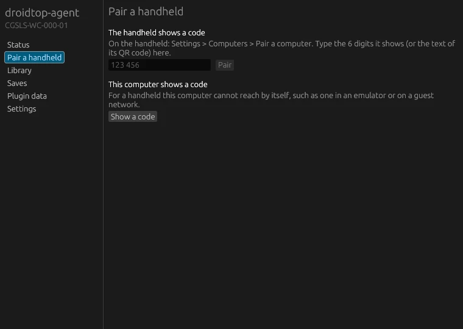
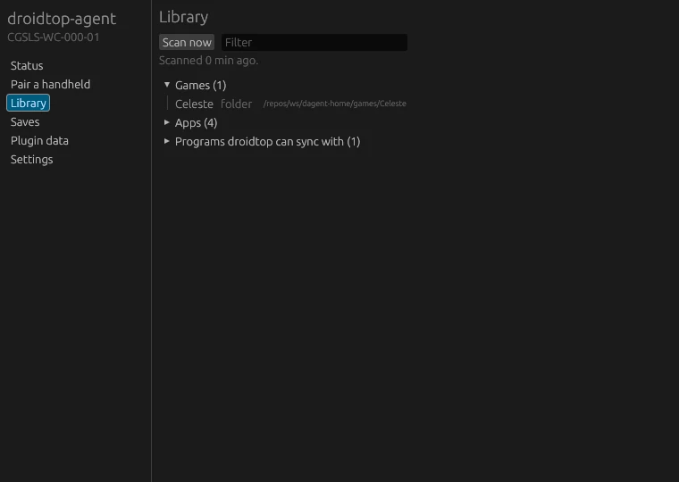

<h1 align="center">droidtop-agent</h1>

<p align="center">
  <b>Your computer, in step with your handheld.</b><br>
  Saves, game library, apps and plugin data, kept in sync with droidtop over your own network.
</p>

<p align="center">
  <a href="https://github.com/Droidtop/droidtop-agent/releases/latest"></a>
  <a href="https://github.com/Droidtop/droidtop-agent/actions/workflows/ci.yml"></a>
  
  <a href="LICENSE"></a>
  
</p>

<p align="center">
  <a href="#what-it-does">What it does</a> ·
  <a href="#install">Install</a> ·
  <a href="#get-started">Get started</a> ·
  <a href="#faq">FAQ</a> ·
  <a href="#build">Build</a> ·
  <a href="#licence">Licence</a>
</p>

droidtop-agent is a small program for a Windows, Linux or macOS computer that pairs with [droidtop](https://github.com/Droidtop/droidtop) on a handheld. It runs in the tray, with a command line for headless machines.

<table>
  <tr>
    <td width="50%" valign="top">
      
      <br><sub><b>Pair.</b> Type the handheld's code, or show one here.</sub>
    </td>
    <td width="50%" valign="top">
      
      <br><sub><b>Library.</b> What the agent found on this computer.</sub>
    </td>
  </tr>
</table>

## What it does

| | |
|---|---|
| **Saves** | Before a game starts on the handheld and after it ends, its saves are brought up to date with the computer's copy. If both sides changed, the newest wins, or the device you made primary. The other keeps its own as a copy, with a few older ones. Nothing is deleted. |
| **Library** | Scans for Steam, GOG, Epic, Amazon, itch, Battle.net, Heroic, Lutris, Bottles and Minigalaxy games, your own game folders, and ROM folders laid out by ES-DE system name. Both libraries stay in step. |
| **Apps** | Lists the other programs installed here too: Windows programs and Store apps, Linux desktop apps including Flatpak and Snap, and macOS applications. |
| **Plugin contexts** | Syncs data that droidtop plugins share with programs on the computer. A plugin can ship a small adapter, and the agent installs it only when you approve, checked against the digest the plugin names. |
| **No VPN needed** | On your own network the two devices talk directly. Away from it they use a direct WireGuard tunnel, or a folder your own sync tool carries to both. |

Any number of handhelds and computers can pair with each other. The agent does not stream your screen or control the computer. That is [windowcast](https://github.com/Droidtop/windowcast).

## Install

Pick the newest build on the [releases page](https://github.com/Droidtop/droidtop-agent/releases/latest).

| System | Download |
|---|---|
| Windows (x86_64) | `droidtop-agent-app-windows-x86_64.exe` |
| macOS (arm64 or x86_64) | `droidtop-agent-macos-<arch>.app.zip`. It is not signed yet, so the first time, use Open from the right-click menu. |
| Linux (x86_64 or aarch64, glibc 2.39+) | The one-line installer below, or a `.deb`, `.rpm`, `.run` or `.tar.zst` from the release |

Linux, for you only and without root:

```
curl -fsSL https://github.com/Droidtop/droidtop-agent/releases/latest/download/install.sh | sh
```

It checks the download against `SHA256SUMS` and lists everything it creates in `~/.local/share/droidtop-agent/install-manifest`. Run `~/.local/share/droidtop-agent/uninstall.sh` to remove exactly that list. More in [docs/USAGE.md](docs/USAGE.md).

## Get started

1. Run **droidtop-agent-app**. It sits in the tray.
2. On the handheld, open droidtop **Settings > Computers > Pair a computer**. It shows six digits.
3. In the agent's **Pair a handheld** page, type them and press **Pair**.
4. If your firewall asks, allow the agent on your home network. It listens on port 47610 (TCP and UDP), and on UDP 47611 for WireGuard from outside.

For headless machines and scripts:

```
droidtop-agent pair 123456      # the code droidtop shows
droidtop-agent                  # keep it running
droidtop-agent scan             # what it found on this computer
droidtop-agent saves steam:440  # where a game's saves are, and the files
droidtop-agent autostart on     # start when you sign in
```

The design is in [docs/DESIGN.md](docs/DESIGN.md).

## FAQ

**Where does it find save locations?**
From the [Ludusavi manifest](https://github.com/mtkennerly/ludusavi-manifest), which gets its data from PCGamingWiki. Your own Ludusavi custom games are used too, and `droidtop-agent saves add` covers anything else.

**Could a sync lose a save?**
The agent never deletes a save. When both sides changed, the losing copy is kept beside the winner.

**What do I do away from home?**
The agent finds the handheld the way Syncthing does and punches through both routers. Only addresses go to the discovery servers, and the sync itself goes through the direct tunnel. When that fails, forward UDP 47611 and run `droidtop-agent endpoint set <public ip>:47611`, or name a shared folder with `droidtop-agent share set <folder>`. Details are in [docs/USAGE.md](docs/USAGE.md).

**Does it start by itself?**
Only if you turn it on with `droidtop-agent autostart on`.

## Build

```
cargo build --release -p droidtop-agent -p droidtop-agent-app
```

CI builds both programs for Linux, Windows and macOS, and droidtop's Android library, on every push. Each green build on `main` is published as a release.

## Licence

GPL-3.0-only, see [LICENSE](LICENSE). The agent uses windowcast's `identity` and `pairing` crates, which are GPL-3.0-only.
